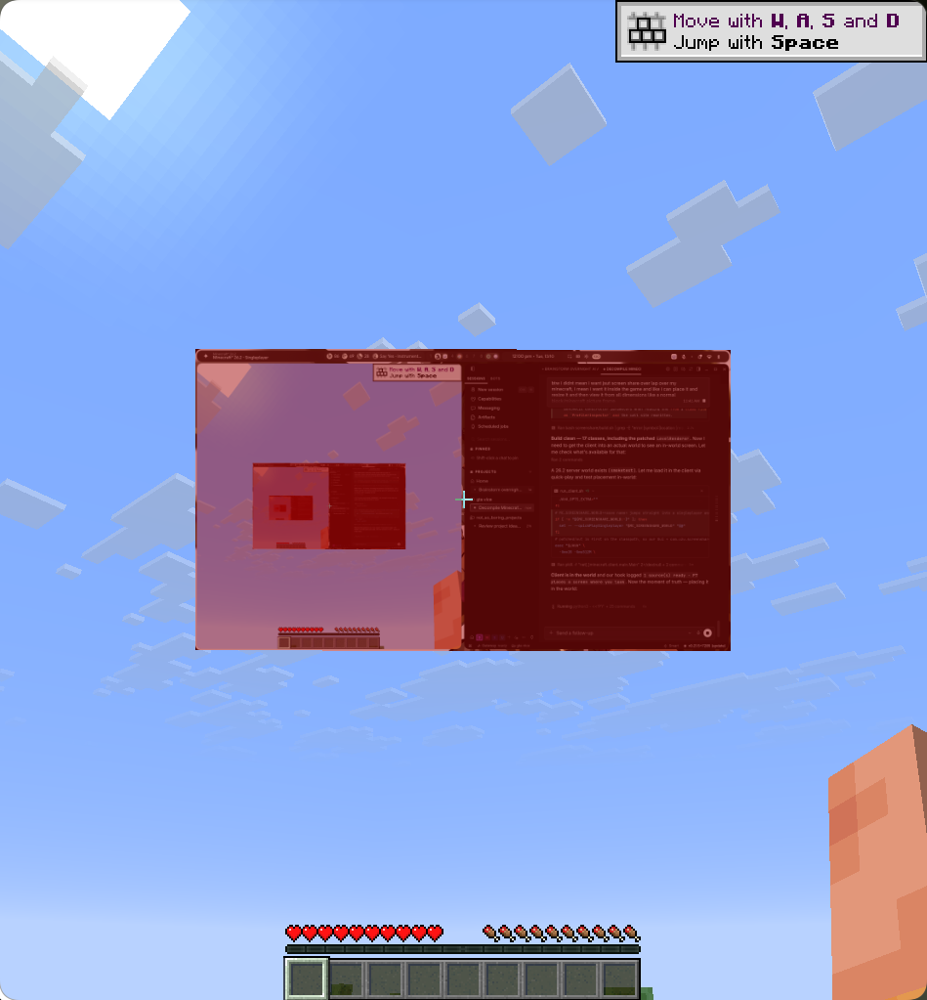

# In-world screen share for Minecraft

Live screen content — your desktop, a single application, or a whole window — rendered on flat panels
**inside** the Minecraft world. Walk around them, they are occluded by blocks, they fog with distance,
and they are lit by the world like any other surface.



Capture is `grim` (wlr-screencopy) publishing PPM frames into `/dev/shm`; the client reads them
straight into GL textures. No mod loader, no jar to drop in — the client is patched directly.

## How it works

Three layers, each independently testable (details in [`screenshare/README.md`](screenshare/README.md)):

| Layer | What it does | Where |
|---|---|---|
| **1. capture** | one frame file per source in `/dev/shm/mcscreen`, plus a manifest the game polls | `screenshare/capture_service.py` |
| **2. transport** | a small binary frame format: header, then RGB payload | `screenshare/frame_format.py` ⇄ `patched/src/com/uzu/screenshare/FrameReader.java` |
| **3. client patch** | hooks in the game's own `Gui`, `LevelRenderer` and `Main`, plus `com.uzu.screenshare.*` classes compiled over the jar's | `screenshare/patch_*.py`, `patched/src/` |

Why patched rather than a mod: this targets a decompiled Minecraft 26.2 tree
([MCP-Reborn](https://github.com/Hexeption/MCP-Reborn)), so the game's own classes are editable. The
build compiles `patched/src` into `patched/out` and puts that directory **first** on the runtime
classpath, so these classes shadow the jar's without modifying it.

## Quickstart

You need a Linux Wayland desktop (Hyprland + `grim`), Python 3 with Pillow, a JDK 25, a Mojang 26.2
install, and a decompiled Minecraft tree to compile against.

```bash
bash tools/fetch_vineflower.sh                                    # decompiler (pinned, checksum-verified)
python3 tools/check_launch.py                                     # notes/classpath.txt
python3 tools/unsign_jar.py                                       # unsigned/26.2-unsigned.jar
bash tools/decompile_class.sh net.minecraft.client.gui.Gui        # the classes we hook
bash tools/decompile_class.sh net.minecraft.client.renderer.LevelRenderer
bash screenshare/build.sh                                         # patched/src -> patched/out
python3 screenshare/prepare_libs.py                               # classpath.txt + LWJGL natives

bash screenshare/play.sh                                          # capture + client, one command
```

`play.sh` also takes `--status`, `--stop` (leaves your screen channels up) and `--purge` (closes
everything: processes, virtual screens, frames).

## Controls

| Key | Action |
|---|---|
| **F7** | Place a panel where you look, bound to the next unused source |
| **F8** | Toggle edit mode |
| **TAB** | Select next panel |
| **Arrows** | Move it along its own right/up axes |
| **+ / -** | Resize |
| **[ / ]** | Rotate yaw (15° steps) |
| **; / '** | Tilt pitch |
| **N** | Cycle the panel's capture source |
| **DEL** | Remove |
| **R** | Re-level every panel in front of you |

Layouts persist per-dimension in `<gameDir>/screenshare.json`.

## One screen per application

Region capture cannot isolate an application: `grim -g <rect>` returns whatever the compositor shows
there, so two maximised windows yield the same pixels. A **screen channel** gives an application its
own virtual output instead, which is exact — and `attach` does that to a window you already have
open, with no relaunch and no second profile:

```bash
screenshare/app_screens.sh windows                                # what could go on a screen
screenshare/app_screens.sh attach music google-chrome --title ...  # a window already open
screenshare/app_screens.sh add  music -- spotify                   # or launch one
screenshare/app_screens.sh list
screenshare/app_screens.sh remove music
```

Design findings and the failure modes that shaped it: [`notes/CHANNELS.md`](notes/CHANNELS.md).

## Requirements and constraints

- **Wayland only.** Capture is `wlr-screencopy` via `grim`; there is no X11 path. With no
  `xdg-desktop-portal` installed, the PipeWire ScreenCast route is unavailable on the dev box this
  was built on, which is why capture goes through `grim`.
- **The client runs through XWayland** — this build's GLFW is X11-only. XWayland windows do not
  receive Wayland virtual-keyboard events, so scripted input must use `ydotool` (uinput), not
  `wtype`.
- **View-only.** Injected input lands on the *focused* window, so driving an in-world screen would
  mean the game cannot be focused — i.e. cannot be played. Panels display; they do not control.
- **Patch anchors break between versions** by design. Anything that changes the shape of `Gui` or
  `LevelRenderer` invalidates the `require(...)` counts in `screenshare/patch_*.py`.

## Not in the repo, on purpose

Derived Mojang artifacts — the unsigned client jar, the decompiled tree, the patched classes and the
built output — plus the MCP-Reborn/Gradle base this layers onto. All are reproducible from the tools
above (see Quickstart), and none of them belong in version control.

## Verified

The screenshots in [`screenshare/layouttest/`](screenshare/layouttest/) are real captures from the
running game. The measurements behind the memory/CPU tuning — a launch with the game's heap trimmed
cut peak JVM RSS 1119 → 833 MB and major page faults 4286 → 852 — are in
[`screenshare/README.md`](screenshare/README.md#keeping-the-desktop-smooth-memory-and-cpu).
